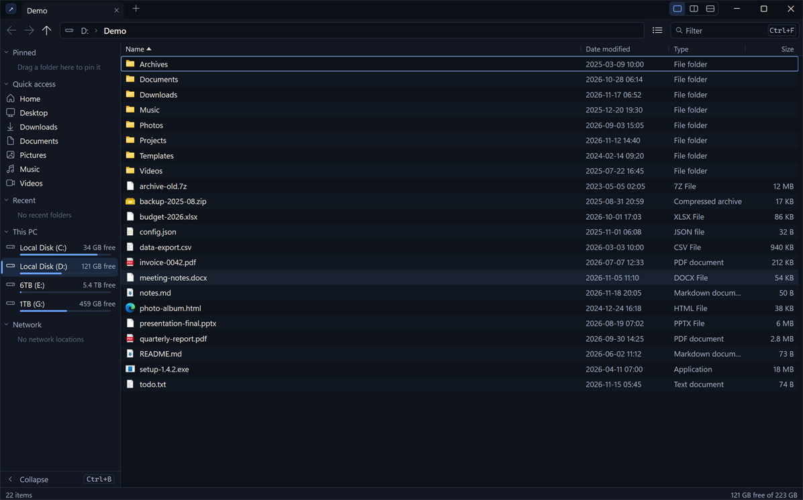
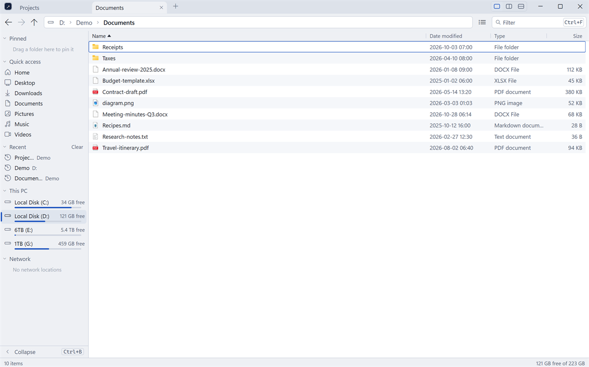
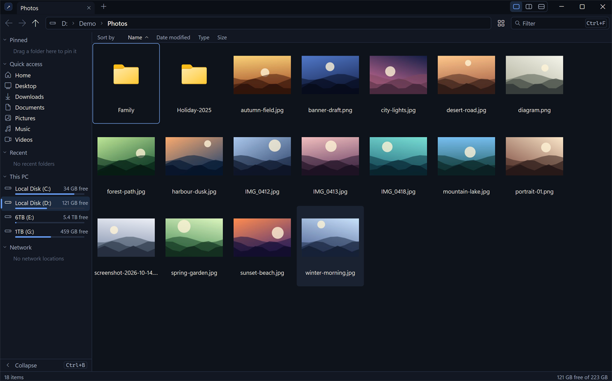
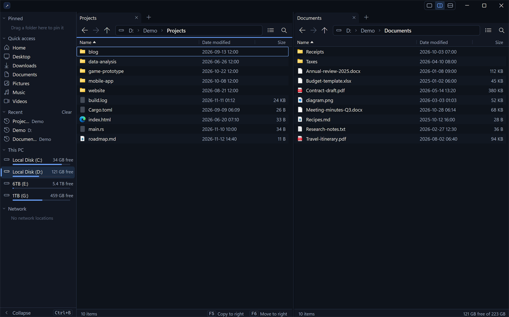
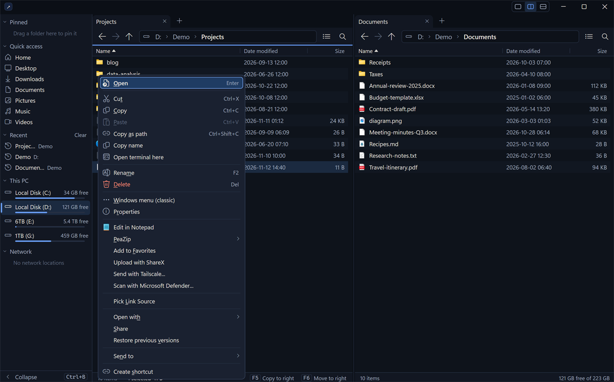
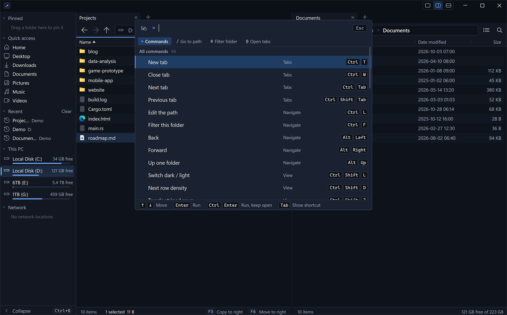
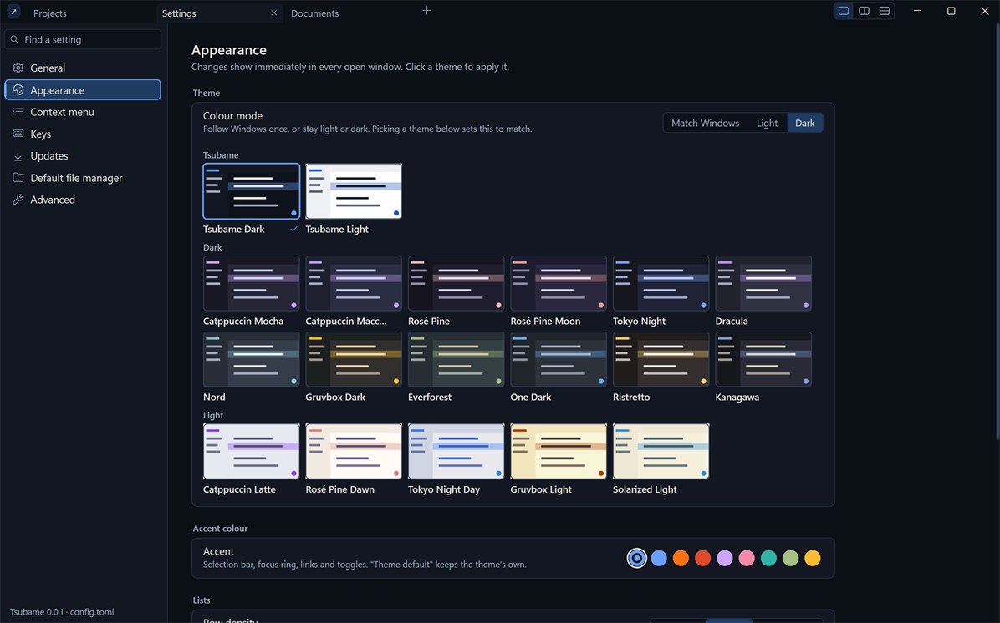

<p align="center">
  
</p>

Tsubame (燕, "swallow") is a file browser for Windows written in Rust. It has only been tested on Windows 11. It talks to Win32 directly, draws with Direct2D and DirectWrite, and uses its own small immediate-mode UI kit instead of a framework. The goals are fast startup, fast scrolling through very large folders, and memory that stays flat however long it runs.

## Status

Pre-release, version 0.1.0. There is no stable release yet, so there is nothing to download: build it from source (below). The installer, the signed update manifest and the release workflow exist in the repository but have only been exercised as dry runs. Expect missing features and rough edges.

## Features

What exists today:

- **Views:** details with sortable columns, and a grid view (small and large cells) with real thumbnails and rubber-band selection. A filter box narrows the folder as you type.
- **Tabs and two panes:** tabs per pane, side by side or stacked, with copy/move to the other pane (F5 / F6). Folder changes made elsewhere show up without a refresh.
- **Sidebar:** pinned folders, quick access, recent folders, drives with free-space bars, network locations. It collapses to a rail.
- **File operations:** copy, move, delete (Recycle Bin or permanent), rename, batch rename with a pattern preview, drag and drop (OLE), and undo/redo across all of them.
- **Context menu:** drawn by Tsubame, with Tsubame's own actions first and the installed Windows shell extensions loaded in the background. Your own entries can be added in Settings, and a Nilesoft Shell `shell.nss` can be imported (read only). The classic Windows menu stays one click away.
- **Command palette** (Ctrl+K or Ctrl+Shift+P): fuzzy-find commands, jump to a path, filter the folder, switch between open tabs.
- **Settings tab** (Ctrl+,): 19 colour themes with accent colours, row density, rebindable keys, update settings, and the default-file-manager switch.
- **Default file manager (opt-in):** a per-user registry verb so that opening a folder from other apps starts Tsubame. It is off by default, needs no administrator rights, and has a Remove button. It does not replace Explorer for drives, the Recycle Bin or Win+E. Details: [docs/default-file-manager.md](docs/default-file-manager.md).
- **Updates:** checks GitHub Releases at most once a day, verifies an ed25519-signed manifest and SHA-256 hashes, and installs only when you restart. Updates can be turned off. Details: [docs/updater.md](docs/updater.md).
- **Command line:** open folders or files, `--new-tab`, `--new-window`, `--select <path>`, `--portable`, `--config <file>`. A second launch hands its paths to the running window. Details: [docs/config.md](docs/config.md).

Not done yet: dragging a tab between panes, synced scrolling, custom theme packs, hiding or renaming Windows' own context-menu entries, a plugin host that users can reach. More in [docs/u4-settings.md](docs/u4-settings.md) and [docs/u3-panes.md](docs/u3-panes.md).

## Screenshots

All screenshots are the real app on Windows 11 at 200% scale, showing a small folder of made-up demo files.

| | |
|---|---|
|  |  |
| Details view, dark | Details view, light |
|  |  |
| Grid view with thumbnails | Two panes and the sidebar |
|  |  |
| Own-drawn context menu | Command palette |



Settings, Appearance

## Performance

Each feature has a budget, and a harness measures the real app against it. These are the latest numbers from that harness, copied from [docs/bench-log.md](docs/bench-log.md) and [docs/ctxmenu-validation.md](docs/ctxmenu-validation.md). They are Tsubame's own measurements. Nothing here has been compared with other file managers, so there is no "faster than X" claim.

Measured on a release build (`lto`, `strip`), 2,859,008 B, on a desktop with a 12-core Ryzen 9, an RTX 3080 and a 4K display at 200% scale. The harness launches the app 10 times for startup and scrolling, opens a folder of 100,000 empty files (9 navigations per run), and then drives 10,000 navigations and 1,000 tab open/close cycles in one process to look for leaks. Every figure comes from the app's own reports, not an outside profiler. Full method: [docs/bench.md](docs/bench.md).

| Metric | Budget | Latest measured | Result |
|---|---|---|---|
| Cold start to first painted frame | < 100 ms median | 71.00 ms median, 95.70 ms p95 (n=10) | within budget |
| Open a 100,000-entry folder: first rows | < 30 ms median | 4.32 ms median, 28.44 ms p95 (n=9) | within budget |
| Open a 100,000-entry folder: complete and sorted | < 200 ms median | 51.18 ms median, 99.10 ms p95 (n=9) | within budget |
| Same folder, cold file cache: first rows / complete and sorted | < 30 ms / < 200 ms median | 13.73 ms / 168.98 ms median; p95 14.73 ms / 221.55 ms (n=3) | within budget on the median; p95 of "complete" is over 200 ms. Measured on an earlier build (commit `cb13120`), not re-measured since |
| Scroll paint p95, details view, 4K | < 5 ms (median of 10 runs) | 2.90 ms median; the worst run's p95 was 4.53 ms | within budget |
| Idle CPU over a 10 s window | 0 wake-ups; < 50 ms CPU | 0 ms CPU in every window 13-43 s after launch (n=3 runs x 3 windows); 0 wake-ups once Windows' thread pool has retired its idle workers, 1-2 per window before that | within budget on CPU; wake-ups see below |
| Private memory, one tab, small folder, 4K | < 110 MB | 64.2 MB | within budget |
| Private memory after a 5 s scroll of the 100,000-entry folder | < 110 MB | 82.2 MB median, 85.1 MB max | within budget |
| Leak gate: 10,000 navigations + 1,000 tabs | private memory within 5% | 81.64 to 84.45 MB (+2.81 MB, +3.4%); handles, GDI, USER objects and threads within their limits | within budget (one run on this build) |
| Executable size | < 6 MB | 2,792 KB | within budget |

Caveats, so the table is not read more kindly than it deserves:

- **Idle wake-ups are now counted, per thread** (`tools/idle-wakes.ps1`). Before the fix the idle process woke ~970 times per 10 s: the NVIDIA driver (`nvwgf2umx.dll`) runs a thread that wakes ~100 times a second for as long as a GPU device exists in the process, whatever the device flags or swap chain (Chromium apps show the same thread). Tsubame's own threads were already silent. The app now lets the GPU device go after 10 s without a paint (the window keeps its last frame) and makes it again on the next input. After that, the only wake-ups are Windows thread-pool workers exiting, 1-2 per 10 s window for the first ~40 s, then none. The cost moves to the first input after an idle stretch: one ~13 ms software frame, then the GPU is back ~160-180 ms later (~170 ms of CPU on a worker). Details in `docs/bench-log.md`.
- The leak gate passed three times on an earlier build (worst run +2.8%). On the latest build it ran once, so run-to-run spread is not verified. Run-to-run spread is about as large as the 5% limit: an early build read +10.3% on one of three runs, and the gate fails on the worst run.
- The cold-cache run empties the Windows working set and then starts the app, so it also pays the app's own cold start. It is not a reboot.
- Scroll timing needs a quiet machine. On a loaded one, an earlier build read anywhere from 4.7 to 7.5 ms at different times, so compare builds interleaved in the same session, not across days. A text-clipping fix took the median p95 from 6.18 ms to 2.70 ms in such an interleaved run.

Own-drawn context menu, 200 real menus opened and closed in one process (the same build):

| Metric | Tsubame's menu | Windows' native popup |
|---|---|---|
| First painted frame, cold (first menu of the process) | 2.315 ms | 508.98 ms |
| First painted frame, warm, median / p95 | 1.29 / 1.71 ms | 33.59 / 39.78 ms |
| Complete shell-extension tree loaded, cold | 615.08 ms | not comparable |
| Complete shell-extension tree loaded, warm, median / p95 | 162.21 / 200.98 ms | not comparable |
| Private memory growth, menu 10 to menu 200 | +4.8 MB (+6.8%) | +5.7 MB (+8.3%) |

Tsubame's own rows appear at once and the shell extensions fill in as they answer, which is why the first frame is so early. The memory growth is over the 5% target for repeated menus, for both paths. The own-drawn menu grows less than the native one, but it does not pass that gate.

## How it is built

- **Rust 2024, raw Win32.** One native window, `windows` crate bindings, no webview and no UI framework.
- **Direct2D and DirectWrite**, with an immediate-mode UI kit written for this project (`crates/tsubame-ui`).
- **The UI thread never touches the disk or COM.** Workers enumerate folders, resolve icons and thumbnails, run file operations and query shell menus on their own threads and send batches back, tagged with a generation number so stale results are dropped.
- **Entries are stored as flat arrays,** only the visible rows are drawn, and every cache (icons, thumbnails, text layouts) has a byte or count cap.
- **Small workspace:** `core`, `win`, `ui`, `d2d`, `config`, `update`, `handler`, `ext-api`, `plughost` and `bench` crates under `crates/`. The design, budgets and architecture rules are in [docs/PLAN.md](docs/PLAN.md); topic notes are in [docs/](docs/).

## Installing

The 0.1.0 installers are not code-signed (there is no Authenticode certificate yet), so Windows
SmartScreen shows "Windows protected your PC" the first time you run the setup or the app. Choose
More info > Run anyway. That warning only covers the first run of an unsigned file: updates are
checked against a signing key built into the app, so they are verified either way. A `SHA256SUMS`
file is published with each release if you want to check a download yourself.

Want to test unreleased changes? There is an opt-in nightly channel: see [TESTERS.md](TESTERS.md).

## Building from source

You need Windows 10 or 11, a recent stable Rust toolchain with the MSVC target (edition 2024), and the Visual Studio Build Tools (MSVC and a Windows SDK). From the repository root:

```
cargo build --release
target\release\tsubame.exe C:\
```

`cargo test --workspace` runs the unit tests. One test that uses the real Windows clipboard (`clipboard_round_trip`) is sensitive to what else is running on the machine and can fail on its own; skip it with `-- --skip clipboard_round_trip` if it does.

For measurement runs, `tsubame.exe --bench` and `--leak-gate` are the app's own report modes; see [docs/bench.md](docs/bench.md).

## Data and privacy

- Settings live in `config.toml` and the last session in `session.toml`, under `%APPDATA%\Tsubame`. Put a `portable.txt` or `tsubame.portable` file next to the exe (or pass `--portable`) to keep them in a `data` folder beside it instead.
- Files are written atomically and not more than once every two seconds. A corrupt file is moved aside as `.bad` and the defaults are used.
- There is no telemetry and no account.
- The only network use is the update check: one request to GitHub's releases API at most every 24 hours, and none if you turn it off in Settings > Updates. Downloads are verified before they are used and are only applied when you restart.
- The default-file-manager switch is off until you turn it on. It writes one per-user registry key, and Remove puts things back.

## Contributing

Issues and pull requests are welcome, but the project is young and the code moves quickly, so please open an issue before starting anything large. Run `cargo test --workspace` and `cargo clippy --workspace` before sending a change. Anything on the hot path (listing, scrolling, startup, memory) should come with a before and after from the harness in [docs/bench.md](docs/bench.md). The architecture rules above, especially "the UI thread never touches the disk or COM", are the ones most worth keeping in mind.

## License

MIT. See [LICENSE](LICENSE).
